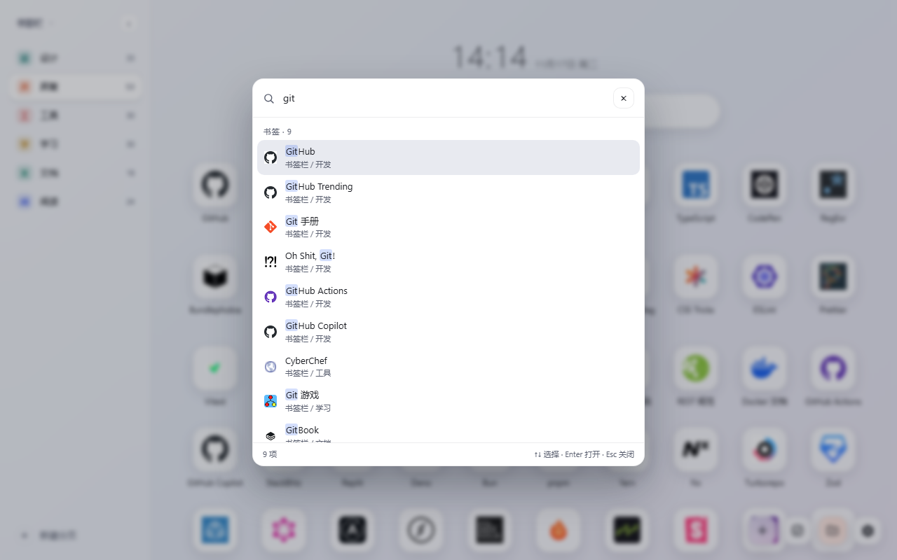

# Bookmark Deck

用浏览器书签本身当数据源的 iTab 风格新标签页。左侧竖排分页，每页里是图标网格与文件夹卡片，拖拽排序直接调用 `chrome.bookmarks` 写回，不存在"两边同步"的问题，因为只有一份数据。


## 装

1. 打开 `chrome://extensions`（Edge 用 `edge://extensions`）
2. 右上角打开「开发者模式」
3. 点「加载已解压的扩展程序」，选本目录（或先跑 `python scripts/pack.py` 后选 `dist/`）
4. 新开一个标签页

不需要构建，没有第三方依赖。后台只有一个十几行的 service worker，负责工具栏图标点击与首次安装时打开引导。

## 用法

| 操作 | 说明 |
|---|---|
| 点左侧分页 | 切换页面，每页对应书签栏里的一个一级文件夹 |
| 点图标 | 当前页打开，中键或 Ctrl+点击新标签页打开 |
| 点文件夹卡片 | 弹层展开，面包屑可回退，支持多层嵌套 |
| 拖图标 | 页内排序；拖到左侧另一个分页上，整条移动到那页 |
| 拖到文件夹卡片上 | 放进该文件夹 |
| 右键图标 | 打开 / 复制网址 / 编辑 / 移动到分页 / 删除 |
| 右键文件夹 | 打开 / 全部在新标签页打开 / 重命名 / 移动到分页 / 删除 |
| 右键分页 | 重命名 / 上移 / 下移 / 删除整页 |
| 右键空白处 | 搜索书签和标签 / 撤销上一步 / 添加书签 / 新建文件夹 / 新建分页 / 更换壁纸 |
| Ctrl+Z | 撤销上一步（新建、删除、改名、移动、建组、布局调整） |
| 侧栏底部 + | 新建分页，等于在书签栏建一个文件夹 |
| 侧栏右上角 ‹ | 收起成只剩头像的窄条 |
| 右下角 + | 在当前分页（或当前打开的文件夹）新增书签 |
| 右下角文件夹图标 | 在当前位置新建文件夹，可以在弹层里继续嵌套 |
| Ctrl+K | 聚焦搜索框，按当前搜索源搜索（本机书签+标签，或选定的搜索引擎） |
| 右下角齿轮 | 设置：主题、主题色、壁纸、布局、图标大小、空分页、书签来源、重载扩展 |
| 方向键 | 在图标网格里按位置移动焦点，`Home` / `End` 到首尾，`Enter` 打开文件夹 |
| F2 / Delete | 焦点在图标的改名 / 删除 |
| Ctrl、Shift + 点击 | 多选（切换 / 范围），选中后底部出现批量条，可整批移动或删除 |
| Esc | 依次关闭菜单、搜索结果、弹窗、设置，或者清空选择 |

层级映射：书签栏的一级文件夹 = 左侧分页；分页里的书签 = 图标；分页里的子文件夹 = 文件夹卡片，点开继续下钻。层级不限深度，`项目 / aigc / 文` 这种三层结构点两下就能到底，面包屑可以逐级回退。

## 开发

```bash
# 冒烟测试：用无头 Chrome 跑真实页面结构，覆盖渲染、拖拽插入、建组、搜索、键盘、多选
node tests/run.mjs

# 容量验证：造 3200 条书签，确认 8 个分页、当前页 400 个图标能正常渲染
node tests/stress.mjs

# 生成发布包（只含必要文件，约 120KB）
python scripts/pack.py
```

测试用的桩在 `tests/stub.js`，它按真实 Chrome 的行为模拟 `bookmarks.move`（同父级、目标索引大于源索引时内部减一）。改拖拽逻辑时这个细节不能漏，否则测试会假绿。

演示模式用的书签快照是 `dev/mock.js`，由本机 Chrome 的 `Bookmarks` 文件导出，不进仓库也不进发布包。没有它时 `node tests/run.mjs` 会提示。

## 改了代码怎么生效

不需要重新安装，也不需要删掉再加载。扩展目录就是源码目录，文件已经在位，缺的只是让 Chrome 重新读一遍：

1. 打开扩展页，点当前扩展卡片上的刷新图标（⟳）；或者在新标签页按 `Ctrl+Alt+R`（扩展自带的重载快捷键）
2. 按 F5 刷新新标签页

只有改了 `manifest.json` 里的权限或名称，Chrome 才会提示要重新启用一次。日常改 `app.js` / `app.css` 走上面两步就够。

如果想连这一步都省掉，装一个自动重载类扩展（如 Extensions Reloader），它替你监听文件变化并点那个刷新按钮。

## 右键菜单


| 位置 | 菜单项 |
|---|---|
| 书签图标 | 在新标签页打开、在当前页打开、复制网址、编辑、移动到分页（子菜单列出所有分页）、删除书签 |
| 文件夹卡片 | 打开、在新标签页打开全部（超过 12 个会二次确认）、重命名、移动到分页、删除文件夹 |
| 左侧分页 | 打开这一页、重命名、上移、下移、删除分页 |
| 空白处 | 搜索书签和标签、添加书签、新建文件夹、新建分页、更换壁纸 |

子菜单会列出全部分页，当前所在的页自动排除；分页太多时子菜单自身滚动。菜单贴近窗口右边缘时会自动向左展开。

## 搜索


顶栏搜索框左边是搜索源选择器，默认 Google，可切换：

| 搜索源 | Enter 行为 |
|---|---|
| 书签与标签 | 在本机数据里筛，结果显示在输入框下方的下拉面板 |
| Google / 必应 / 百度 / DuckDuckGo / 搜狗 / 知乎 / 哔哩哔哩 | 用该引擎搜当前关键词，当前标签跳转 |
| 自定义 | 菜单底部「添加自定义搜索引擎…」，填名称和含 `%s` 的地址模板，例如 `https://search.example.com/?q=%s` |

自定义引擎在菜单里带子菜单，可以「使用」或「删除」。选择结果写入 `chrome.storage.local`，换页不丢。

### 书签与标签



选到「书签与标签」时，顶栏下拉和右键「搜索书签和标签」是同一套结果，两个入口分别呈现为下拉面板和居中命令面板：

| 组 | 数据源 | Enter 的行为 |
|---|---|---|
| 标签 | `chrome.tabs.query`，只列普通网页，跳过扩展页与本页 | 切到那个标签，把它所在窗口提到前台 |
| 书签 | 整个书签树，副标题显示所在路径（如 `书签栏 / 开发 / 计算机科学`） | 在当前标签打开 |

关键词为空时列出「最近搜索」和打开的标签，相当于标签切换器加历史入口；输入后只剩标签与书签两组，空组自动隐藏。


最近搜索最多留 20 条，按「关键词 + 搜索源」去重，越新的越靠上。用引擎搜索回车时记录，本地搜索在选中结果时记录。分组标题右侧的「清空」一键清掉全部历史。`↑↓` 选择、`Enter` 确认、`Esc` 关闭，点击面板外也会收起。

标签搜索需要 `tabs` 权限（读取标题和网址），首次升级时 Chrome 会提示重新启用一次。

## 自由摆放


齿轮面板里可以把布局切成「自由摆放」，图标就能拖到任意格子，位置记在本机 `chrome.storage.local`，按文件夹分别保存：

拖动时的判定只看**落点位置**，不需要按住等：

| 落在哪里 | 提示 | 松手结果 |
|---|---|---|
| 盖住另一个图标（两个方块重叠过半） | 只包裹图标方块的蓝框 | 新建文件夹，把两者收进去（弹窗问名字） |
| 目标图标的左边或右边 | 对应侧一条蓝色竖条（高度只覆盖图标，不含标题行） | 插到那一侧，其余图标顺延（位置按浏览器书签顺序计算，连续拖动也不会错位） |
| 没有图标的空白处 | 无 | 吸附最近的格子；目标格子被占就互换位置 |
| 文件夹卡片上 | 蓝框 | 放进那个文件夹 |

- 空白处右键「整理布局」：按当前顺序重排并清空本页坐标


网格模式下同一套分区规则，只是图标不跟手，判定用指针位置：指针落在目标图标的中间区域（水平 ±45% 半宽、垂直在图标方块内）就是建组，落在它左右两侧就是插入。

**顺序是双向的。** 自由布局里的顺序按「从上到下、从左到右」换算，每次拖完会把结果写回浏览器书签顺序，在 Chrome 书签管理器里看到的排列也跟着变；反过来，在书签管理器里调了顺序，重载后同样的格子会按新顺序重新分配内容，布局形状不变。

坐标存的是行列号而不是像素，所以改图标大小后布局不会乱。书签的增删改仍以浏览器书签为准，坐标只是视图层，缺失时自动补到空位。

## 设置


右下角齿轮打开抽屉：

| 项 | 说明 |
|---|---|
| 主题 | 跟随壁纸 / 浅色 / 深色。跟随壁纸时按图片平均亮度自动选，深色会把壁纸压暗到 45% 保证可读 |
| 主题色 | 6 个预设 + 自定义取色器，作用于选中态、主按钮、拖拽提示、侧栏指示点 |
| 壁纸 | 5 套渐变 + 本地图片（6MB 以内，存为 data URL） |
| 布局 | 网格 / 自由摆放 |
| 图标大小 | 小 / 中 / 大 |
| 书签来源 | 书签栏 / 其他书签 / 移动设备书签 |

## 撤销

`Ctrl+Z` 或空白处右键「撤销上一步」。栈最多 40 步，覆盖：

| 操作 | 撤销行为 |
|---|---|
| 新建书签 / 文件夹 / 分页 | 删除新建的那个节点 |
| 删除书签 / 文件夹 / 分页 | 按删除前的完整子树在原位置重建 |
| 改名 / 改网址 | 写回旧值 |
| 移动（网格排序、跨分页、放进文件夹） | 移回原来的父级与位置 |
| 建组 | 两项移回原位，删掉新建的文件夹 |
| 自由布局拖动 | 恢复该文件夹的书签顺序与坐标快照 |

撤销栈在内存里，刷新页面后清空。撤销过程中不会再记录新的撤销项。

## 跨浏览器

| 浏览器 | 状态 |
|---|---|
| Chrome / Edge | 主要目标，已在本地加载验证 |
| Firefox | `browser_specific_settings` 已写进 manifest，图标改走公共 favicon 服务（Firefox 没有 `_favicon`）。没有在 CI 里验证 |
| Safari | 未适配，需要 Xcode 封装 |

## 隐私

不联网、不上传，所有设置存在本机 `chrome.storage.local`。细节见 [PRIVACY.md](PRIVACY.md)。

## 设计约束

- **建组只能靠位置区分，没有第二个确认步骤。** 网格里指针略偏就会从建组变成插入，反过来也一样；蓝框和竖条是唯一的反馈，看清再松手。
- **书签顺序会被布局改写。** 自由摆放里拖一次图标，实际会调用 `bookmarks.move` 把该文件夹的子项顺序重排成视觉顺序，这是双向映射的代价，也意味着浏览器书签管理器里的顺序不再独立。
- **自由摆放的坐标不随书签同步。** 书签字段里没有坐标，位置只能另存在 `chrome.storage.local`，换设备后回到自动排布。这是"书签为唯一数据源"必然的代价。
- **删书签是真删。** 右键删除有确认框，但确认后调用 `bookmarks.remove`，浏览器和账号同步都会生效。
- **只做书签。** 没有待办、天气、股票这些组件，用新标签页换书签管理器。
- **分页不能独立于书签存在。** 新建分页就是建一个空文件夹，删分页就是删文件夹连同里面的书签，浏览器书签管理器里会同步变化。
- **改动即时生效。** 监听 `onCreated / onRemoved / onChanged / onMoved`，在 Chrome 书签管理器里的修改会立刻反映过来。

## 文件

```
manifest.json   MV3，权限只有 bookmarks / favicon / storage
newtab.html     页面骨架
app.js          全部逻辑，约 600 行
app.css         样式，壁纸与明暗主题
mock.js         演示数据（本机书签快照，已在 .gitignore）
preview.png     截图
```

直接用浏览器打开 `newtab.html` 会进演示模式（读 `mock.js`），可以不上扩展先看效果。

## 已知边界

- 仅 Chromium（Chrome / Edge / Brave），Firefox 的 `chrome.bookmarks` 命名空间不同。
- 图标来自 `_favicon` 内置 API，离线时回落到首字母色块。
- 搜索范围是当前选中的书签根，不跨根。
